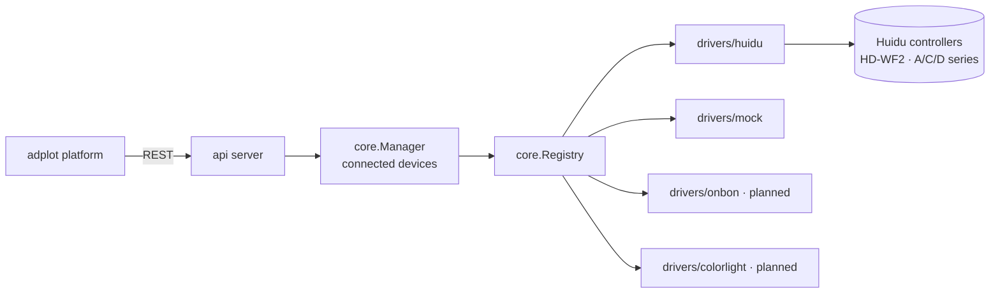

# adplot LED Link

A vendor-neutral gateway between the **adplot** digital signage platform and LED
screen controllers (Huidu, Onbon, Colorlight, …) reached over WiFi or Ethernet.

The goal is to give adplot what tools like Onbon **LedshowYQ**, Huidu
**HDPlayer** and **LedArt** give their users — discovery, content push,
brightness and screen control — without locking adplot to one vendor. LED
controllers speak proprietary protocols, so LED Link is built as a set of
pluggable driver adapters behind one common API.

```
adplot platform ──REST/WebSocket──▶ LED Link ──▶ Huidu │ Onbon │ Colorlight │ …
```

## Status

| Component | State |
|---|---|
| Core model, driver registry, device manager | ✅ working |
| REST API + CLI (`serve`, `scan`, `identify`, `drivers`, `ui`) | ✅ working |
| Browser control interface (embedded in the binary, no install) | ✅ working |
| Desktop app (.deb / AppImage / Windows zip, native window) | ✅ working |
| Generic auto-identification (probe all adapters, connect without knowing the vendor) | ✅ working |
| `mock` driver (simulated screens, for development) | ✅ working |
| `huidu` driver (Huidu SDK 2.0 TCP, wraps [huidu-led](https://github.com/alparslanahmed/huidu-led), MIT) | ⚠️ implemented, **not yet validated on physical hardware** |
| `ddp` driver (open pixel streaming to any DDP receiver: FPP, WLED, ESPixelStick, ESP32/Pi setups) | ✅ implemented, hardware validation pending |
| `colorlight` driver (raw-Ethernet pixel streaming to Colorlight 5A-75x receiver cards) | ✅ implemented (Linux + CAP_NET_RAW), hardware validation pending |
| `reffw` driver (LED Link reference firmware: ESP32/Pi panels with HTTP + DDP) | ✅ implemented, spec in [docs/reference-firmware.md](docs/reference-firmware.md) |
| `onbon` driver (BX-Y1A family) | 🔜 planned, Phase 2 |
| `colorlight` driver (streaming class) | 🔜 planned, Phase 3 |

## Build and run

Requires Go 1.27+.

```bash
go build -o bin/ledlink ./cmd/ledlink
./bin/ledlink                            # start + open the browser interface
./bin/ledlink serve --mock-devices 2     # start with 2 simulated screens
./bin/ledlink drivers                    # list adapters: huidu, mock
```

### Browser interface

Running `ledlink` with no arguments (or `ledlink ui`) starts the service and
opens `http://127.0.0.1:8787/` in your browser — the intended entry point for
day-to-day use. Double-clicking the executable does the same.

The interface is a single page compiled into the binary, so there is nothing
extra to install and it works offline:

- **Screens** — every connected controller with its vendor, address and size.
- **Add screen** — scan the network, or type an IP and let auto-detection work
  out the vendor.
- **Message** — text, colour, effect and speed, sent with one click.
- **Display** — brightness slider and screen on/off.

Everything the UI does is also available through the REST API below.

### Desktop app

For day-to-day use there is a packaged desktop application: the same interface
in a native window, with the LED Link service started and stopped automatically
so nobody has to touch a terminal.

| Platform | Package |
|---|---|
| Ubuntu / Debian | `adplot-ledlink-0.3.0-linux-amd64.deb` |
| Any Linux (portable) | `adplot-ledlink-0.3.0-linux-x86_64.AppImage` |
| Any Linux (archive) | `adplot-ledlink-0.3.0-linux-x64.tar.gz` |
| Windows 10/11 | `adplot-ledlink-0.3.0-win-x64.zip` |

```bash
# Ubuntu / Debian — adds an "adplot LED Link" entry to the application menu
sudo apt install ./adplot-ledlink-0.3.0-linux-amd64.deb

# AppImage
chmod +x adplot-ledlink-0.3.0-linux-x86_64.AppImage
./adplot-ledlink-0.3.0-linux-x86_64.AppImage

# Windows: unzip and run "adplot LED Link.exe"
```

The app picks a free loopback port, starts the bundled gateway, and shuts it
down again when the window closes. Service logs go to
`~/.config/adplot LED Link/ledlink.log`.

Rebuild the packages with:

```bash
./scripts/build-desktop.sh
```

### Try it (no hardware needed)

```bash
# Which family is at this address? (probes every adapter)
curl -X POST http://127.0.0.1:8787/api/v1/identify \
     -H 'Content-Type: application/json' -d '{"address":"mock-1"}'

# Connect without naming a driver — "auto" is the default
curl -X POST http://127.0.0.1:8787/api/v1/devices \
     -H 'Content-Type: application/json' -d '{"address":"mock-3"}'

curl http://127.0.0.1:8787/api/v1/devices
curl -X POST http://127.0.0.1:8787/api/v1/devices/mock-1/text \
     -H 'Content-Type: application/json' \
     -d '{"text":"Hello adplot","color":"#00ff00","effect":"left-scroll-loop"}'
curl -X POST http://127.0.0.1:8787/api/v1/devices/mock-1/brightness \
     -H 'Content-Type: application/json' -d '{"percent":60}'
curl -X POST http://127.0.0.1:8787/api/v1/devices/mock-1/power \
     -H 'Content-Type: application/json' -d '{"on":false}'
```

### Connecting a real controller

1. Join the controller's WiFi access point (Huidu WiFi cards default to
   password `88888888`) or attach it to your LAN.
2. Find it: `./bin/ledlink scan --targets local` (defaults to probing with
   every adapter; a specific address or CIDR also works: `--targets 192.168.6.1`).
3. Ask what it is: `./bin/ledlink identify 192.168.6.1` — every adapter reports
   whether the device speaks its protocol.
4. Connect and control it through the API (`driver` is optional — `"auto"` by
   default):

```bash
curl -X POST http://127.0.0.1:8787/api/v1/devices \
     -H 'Content-Type: application/json' \
     -d '{"address":"192.168.6.1"}'
```

### DIY / open hardware (DDP)

Any panel driven by a DDP-compatible receiver — Falcon Player, WLED,
ESPixelStick, or your own ESP32/Raspberry Pi firmware — joins adplot through
the same API. State the pixel count in the address:

```bash
curl -X POST http://127.0.0.1:8787/api/v1/devices \
     -H 'Content-Type: application/json' \
     -d '{"driver":"ddp","address":"192.168.1.50?w=64&h=32"}'
```

A Colorlight 5A-75x receiver is driven straight from a Linux NIC (Gigabit link;
run with root or `sudo setcap cap_net_raw+ep ./ledlink`):

```bash
curl -X POST http://127.0.0.1:8787/api/v1/devices \
     -H 'Content-Type: application/json' \
     -d '{"driver":"colorlight","address":"enp3s0?w=320&h=256"}'
```

Panels running the [reference firmware](docs/reference-firmware.md) are
discovered and driven automatically — `ledlink identify <ip>` recognizes them:

```bash
curl -X POST http://127.0.0.1:8787/api/v1/devices \
     -H 'Content-Type: application/json' \
     -d '{"driver":"reffw","address":"192.168.1.60"}'
```

## REST API

| Method | Path | Description |
|---|---|---|
| GET  | `/api/v1/healthz` | Service status + version |
| GET  | `/api/v1/drivers` | Registered driver adapters |
| POST | `/api/v1/scan` | Probe targets with all adapters by default: `{"targets","timeout_ms","driver"?}` |
| POST | `/api/v1/identify` | Ask every adapter what is at an address: `{"address"}` |
| GET  | `/api/v1/devices` | Connected devices |
| POST | `/api/v1/devices` | Connect: `{"address"}` — `"driver"` is optional ("auto" default) |
| GET  | `/api/v1/devices/{id}` | Device info |
| DELETE | `/api/v1/devices/{id}` | Disconnect |
| POST | `/api/v1/devices/{id}/text` | Send text (color, font, effect, speed, duration) |
| POST | `/api/v1/devices/{id}/brightness` | `{"percent":1..100}` |
| POST | `/api/v1/devices/{id}/power` | `{"on":true|false}` |
| POST | `/api/v1/devices/{id}/media` | Upload media files by server-side path |

Vendor-neutral effect names (`fade`, `left-scroll-loop`, `up-scroll-loop`,
`left-move`, …) are translated per adapter, so adplot sends the same JSON to
every screen family.

## Architecture



Adding a vendor = implementing `core.Driver` + `core.Device` and registering it.
See `internal/core/driver.go` for the interface and `internal/drivers/huidu/`
for a reference implementation.

### How "generic" works

There is no single protocol that every LED controller speaks, so LED Link is
generic at three levels:

1. **Auto-identification** — `identify` / `driver:"auto"` probe an address with
   every registered adapter; recognized protocols win over mere open ports and
   failed handshakes fall through to the next candidate.
2. **Family adapters** — one adapter covers a whole family of models (the
   `huidu` adapter covers HD-WF2 and the A/C/D series; `onbon` will cover the
   BX-Y family). Adding a new family is one small package implementing
   `core.Driver`.
3. **One vendor-neutral API** — adplot sends the same JSON (text, brightness,
   power, media) to every screen, regardless of vendor.
4. **Open protocols too** — the `ddp` driver speaks the open pixel-streaming
   standard, so DIY receivers and future reference controllers need no vendor
   SDK at all.

## Roadmap

1. **Phase 1 (this scaffold)** — core, REST API, CLI, embedded browser UI,
   Huidu adapter, mock driver, discovery, tests.
2. **Phase 2** — `onbon` adapter (official BX-Y SDK protocol), validated
   against a BX-Y1A.
3. **Phase 3** — packaging (desktop launchers / tray icon); richer streaming
   (images, animation); real-hardware validation for colorlight/DDP/reffw.
4. **Phase 4** — scheduled playlists, more vendors, cloud fallback
   (XiaoHui / Onbon cloud) for devices that can't be reached directly.
5. **Reference firmware** — spec and reference daemon shipped
   ([docs/reference-firmware.md](docs/reference-firmware.md),
   `cmd/ledlink-refd`); ESP32 port pending.

## Development

```bash
go test ./...     # unit tests for discovery, drivers, REST API
go vet ./...
```

```
cmd/ledlink/                CLI entry point (serve, scan, identify, drivers)
cmd/ledlink-refd/           reference firmware daemon (Pi/Linux panels)
internal/core/              vendor-neutral model, driver interface, registry, manager
internal/api/               REST API server
internal/webui/             embedded browser control interface (HTML/CSS/JS)
desktop/                    Electron desktop shell + packaging config
scripts/                    icon generation and desktop build script
internal/discovery/         scan target expansion (local subnet, host lists, CIDR)
internal/ddpwire/           shared DDP packet encoder
internal/render/            rasterizes text/images to RGB frames for streaming drivers
internal/drivers/huidu      Huidu adapter (SDK 2.0 TCP)
internal/drivers/ddp        DDP open pixel-streaming adapter
internal/drivers/colorlight Colorlight 5A-75x raw-Ethernet adapter
internal/drivers/reffw      reference-firmware adapter (HTTP + DDP)
internal/drivers/mock       simulated screens for development and tests
docs/protocols.md           protocol research notes and references
docs/reference-firmware.md  reference firmware specification
```

## Credits

- Huidu protocol implementation: [alparslanahmed/huidu-led](https://github.com/alparslanahmed/huidu-led) (MIT).
- Onbon SDK references: [onbonlab](https://github.com/onbonlab) on GitHub.
- Background research is summarized in [docs/protocols.md](docs/protocols.md).
